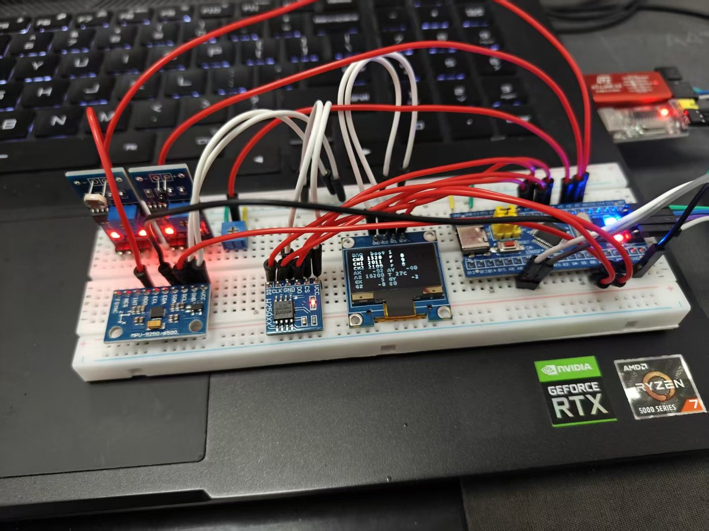
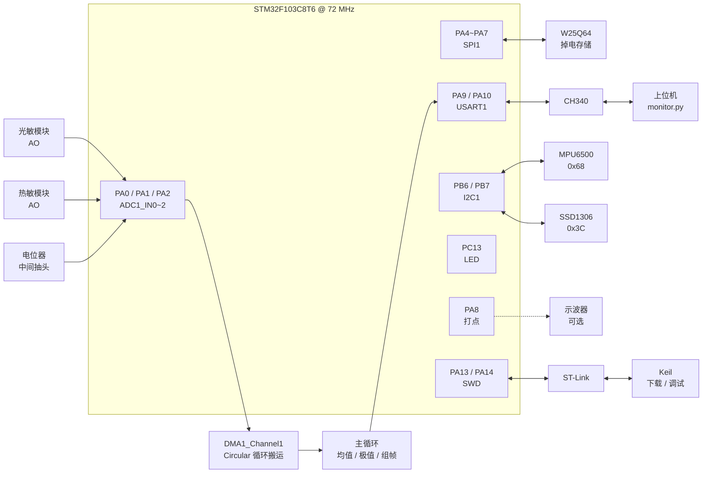

# STM32 多路数据采集 + 上位机监控系统

> 主控 STM32F103C8T6，标准外设库 V3.5.0，ARMCC V5.06 update 5。
> 目标：定时器硬件触发 ADC 多通道采样，DMA 搬运，串口协议上传到 PC 上位机。

## 硬件环境

- 主控：STM32F103C8T6（中密度 MD，72 MHz）
- 调试下载：ST-Link（供 3.3 V）
- 串口：CH340 模块，只接 TXD / RXD / GND，**必须与开发板共地**
- 传感器（3.3 V 供电，接 5 V 会烧 ADC 引脚）：
  - PA0 光敏电阻 AO
  - PA1 热敏电阻（NTC）AO
  - PA2 电位器**中间抽头**（两端接 3.3 V 和 GND）

### 实物接线



面包板上的实际连接：左侧是光敏与 MPU6500 模块，中间是 0.96 寸 OLED（实时显示三路读数），
右侧是 STM32 最小系统板，右上角是 CH340 串口模块。红黑线是 3.3 V 和 GND，其余为信号线。

### 为什么三路里要放一个电位器

光敏和热敏的输出**没有"标准答案"**——你不知道当前是多少 lux、多少度，
所以它们的读数只能看趋势，不能用来判断 ADC 准不准。

电位器是三路里**唯一一个值由你自己决定**的信号源：
拧到底就是 0，拧到头就是 4095，中点应该是 2048。
所以它在这套系统里的角色是**基准源**，用来验证 ADC 的线性度和接线是否正确。

```
读数 ÷ 4095 = 旋钮转过的比例
电压 = 读数 ÷ 4095 × 3.3 V        （1 LSB ≈ 0.806 mV）
```

**用它自检**：慢慢从一端拧到另一端，读数应该连续地在 0 ↔ 4095 之间变化。
- 拧到底到不了 4095 或到不了 0 → 接线问题（多半是 GND 或 3.3 V 没接）
- 读数固定在 0 附近不动 → 只接了 GND 和抽头，3.3 V 那端悬空
- 读数固定在 2100 附近不动（悬空典型电平）→ 抽头这根线没接上
- 读数跳变不连续 → 电位器内部接触不良（常见于便宜的碳膜电位器）

## 外设连线详情

> 本节是**全项目接线唯一的权威说明**，照此可直接复现整套硬件。
> 后面各 D 阶段记录里也有局部接线表，那些是为了讲"为什么这样接"，
> 引脚编号一律以本节为准，如有出入以本节为准。

### 1. 引脚总表

主控 LQFP48 封装（STM32F103C8T6），板上已用 17 个引脚。

| MCU 引脚 | 接到哪 | 信号方向 | GPIO 模式（代码实际配置） | 5 V 容忍 | 说明 |
|---|---|---|---|---|---|
| PA0 | 光敏模块 AO | 输入 | `GPIO_Mode_AIN` | 否 | ADC1_IN0，规则组 rank 1 |
| PA1 | 热敏模块 AO | 输入 | `GPIO_Mode_AIN` | 否 | ADC1_IN1，rank 2 |
| PA2 | 电位器中间抽头 | 输入 | `GPIO_Mode_AIN` | 否 | ADC1_IN2，rank 3 |
| PA4 | W25Q64 CS | 输出 | `GPIO_Mode_Out_PP` 50 MHz | 否 | **软件片选**，非硬件 NSS |
| PA5 | W25Q64 CLK | 输出 | `GPIO_Mode_AF_PP` 50 MHz | 否 | SPI1_SCK |
| PA6 | W25Q64 DO | 输入 | `GPIO_Mode_AF_PP` 50 MHz | 否 | SPI1_MISO |
| PA7 | W25Q64 DI | 输出 | `GPIO_Mode_AF_PP` 50 MHz | 否 | SPI1_MOSI |
| PA8 | 采样打点（可悬空） | 输出 | `GPIO_Mode_Out_PP` 50 MHz | 是 | 每轮翻转，相邻上升沿 = 20 ms |
| PA9 | CH340 RXD | 输出 | `GPIO_Mode_AF_PP` 50 MHz | 是 | USART1_TX |
| PA10 | CH340 TXD | 输入 | `GPIO_Mode_IN_Floating` | 是 | USART1_RX |
| PA13 | ST-Link SWDIO | 双向 | 复位默认（SWD） | 是 | 不要复用为普通 IO |
| PA14 | ST-Link SWCLK | 输入 | 复位默认（SWD） | 是 | 不要复用为普通 IO |
| PB6 | MPU6500 SCL + OLED SCL | 双向 | `GPIO_Mode_AF_OD` 50 MHz | 是 | I2C1_SCL，两器件并联 |
| PB7 | MPU6500 SDA + OLED SDA | 双向 | `GPIO_Mode_AF_OD` 50 MHz | 是 | I2C1_SDA，两器件并联 |
| PC13 | 板载 LED | 输出 | `GPIO_Mode_Out_OD` 2 MHz | 否 | 开漏，只能灌电流 |
| NRST | 复位按键 / ST-Link RST | 输入 | 复位默认 | 否 | 板上已有上拉和按键 |
| BOOT0 | 板载跳线帽 | 输入 | — | 否 | 见第 2 节跳线说明 |

**"5 V 容忍"这一列是硬约束**：标"否"的引脚是 TTa 型（模拟/普通），
直接接 5 V 会经由内部 ESD 二极管灌电流，轻则读数漂移，重则烧引脚。
PA0~PA7、PC13、NRST、BOOT0 都在此列；PA8~PA15、PB6、PB7 是 FT 型，能扛 5 V。
（以数据手册 Table 5 "Pin definitions" 为准。）

### 2. 电源与地

三个供电来源，**必须共地**，否则 ADC 读数乱飘、串口出乱码。

| 来源 | 接到哪 | 说明 |
|---|---|---|
| ST-Link 3.3 V | 开发板 3.3 V | 整套系统的主电源 |
| ST-Link GND | 开发板 GND | **必接**，否则 SWD 都连不上 |
| CH340 VCC | 开发板 5 V（推荐）或 3.3 V | 见下方警告 |
| CH340 GND | 开发板 GND | **必接**，这是最常见的乱码根因 |
| 各传感器模块 VCC | 开发板 3.3 V | **绝对不要接 5 V** |
| 各传感器模块 GND | 开发板 GND | 全部并到同一条 GND |

**五个电源相关的坑**：

1. **CH340 的 VCC 不要既接 5 V 又把它自己的 3.3 V 输出脚接到板子的 3.3 V**。
   两个稳压输出顶在一起，轻则发热，重则烧掉其中一个。**只取一路**。
2. **CH340 若用 5 V 供电，它的 TXD 输出是 5 V 电平**。PA10 是 FT 型能扛，
   但这属于"能用不推荐"——最好把模块上的跳线改成 3.3 V，或直接用 3.3 V 版模块。
3. **面包板的两条电源轨通常是断开的**（中间有缺口）。跨半区接线时要手动短接，
   否则"明明测到 3.3 V 但模块没电"。用万用表在模块的 VCC 脚上量，别在电源轨上量。
4. **ST-Link 的 3.3 V 输出能力有限**（一般 100~200 mA）。本系统实测总电流约 55~60 mA：

   | 部件 | 典型电流 |
   |---|---|
   | STM32F103C8T6 @ 72 MHz | 约 30 mA |
   | OLED（约一半像素点亮） | 15~20 mA |
   | MPU6500 | 3.5 mA |
   | W25Q64（待机 / 擦写瞬时） | 4 µA / 15 mA |
   | 光敏 + 热敏模块（含比较器） | 各 1~2 mA |
   | 电位器（10 kΩ 分压） | 0.33 mA |
   | 板载 LED（PC13 开漏灌入） | 约 3 mA |

   余量够，但别再往 3.3 V 轨上挂电机、继电器、WS2812 这类大电流负载。
5. **VBAT / VDD / VSS / VDDA / VSSA 不用管**。最小系统板上已经把去耦电容、
   VDDA 滤波（10 µF + 100 nF）都做好并内部连好，外部只需提供一路 3.3 V。

**BOOT0 跳线**：接 GND（或跳线帽置 0）= 从 Flash 启动，正常运行；
接 3.3 V = 从系统存储器启动，用于串口 ISP 下载。
本项目用 ST-Link 走 SWD 下载，**BOOT0 保持 0**。
BOOT1 在 F103C8T6 上与 PB2 复用，板上多数直接拉低，不用管。

### 3. ADC 三路模拟输入（PA0 / PA1 / PA2）

| 引脚 | 传感器 | 模块接法 | ADC 配置 |
|---|---|---|---|
| PA0 | 光敏电阻模块 | VCC→3.3 V，GND→GND，**AO→PA0**（DO 悬空） | ADC1_IN0，rank 1，239.5 周期 |
| PA1 | 热敏电阻 NTC 模块 | VCC→3.3 V，GND→GND，**AO→PA1**（DO 悬空） | ADC1_IN1，rank 2，239.5 周期 |
| PA2 | 电位器（10 kΩ 直插） | **两端→3.3 V 和 GND，中间抽头→PA2** | ADC1_IN2，rank 3，239.5 周期 |

**采样时间 239.5 周期不是随手选的**：ADCCLK = 12 MHz 时单次转换 = (239.5 + 12.5) / 12 MHz ≈ 21 µs。
三通道合计约 63 µs，远小于 10 ms 的采样周期。采样时间取最大档，
是因为光敏/热敏模块的输出阻抗偏高（kΩ 级），采样电容需要足够的充电时间，
否则读数系统性偏小。**这是"读数总是偏低一点"的常见根因之一。**

**DO 引脚必须悬空**：模块上的 DO 是比较器数字输出，接进来只会引入干扰，
本项目全程用 AO 走 ADC。如果模块只有 3 个脚（VCC/GND/AO），忽略这条。

### 4. 串口 USART1（PA9 / PA10）与 CH340

| CH340 模块脚 | 接到 | 说明 |
|---|---|---|
| VCC | 开发板 5 V 或 3.3 V（**只取一路**） | 见第 2 节警告 |
| GND | 开发板 GND | **必接** |
| **TXD** | **PA10** | 模块发 → MCU 收 |
| **RXD** | **PA9** | 模块收 → MCU 发 |
| 3V3（若有输出脚） | **悬空** | 别和板子的 3.3 V 短接 |

**必须交叉接**：模块 TXD 对 MCU RX，模块 RXD 对 MCU TX。
同名相接（TXD 接 TXD）是最经典的"能通电但收不到任何数据"。

串口参数（`driver_usart.c`）：**115200 / 8 数据位 / 1 停止位 / 无校验 / 无流控**。
上位机 `monitor.py` 默认值和这里一致，改了一边另一边必须跟着改。

**ST-Link 的 TX/RX 不要接**：ST-Link V2 的排针上也有 TX/RX 脚，
如果同时把 ST-Link 的 TX 和 CH340 的 TXD 都接到 PA10，两个推挽输出会顶在一起。
本项目只用 ST-Link 的 **SWDIO / SWCLK / GND / 3.3 V** 四根线，其余全部悬空。

### 5. I2C1 总线（PB6 / PB7）：MPU6500 + OLED 共用

一条总线挂两个从机，靠地址区分，硬件上就是简单并联。

| 器件 | 模块脚 | 接到 | 地址 |
|---|---|---|---|
| MPU6500 | VCC（脚 1） | 3.3 V | — |
| MPU6500 | GND（脚 2） | GND | — |
| MPU6500 | SCL（脚 3） | **PB6** | — |
| MPU6500 | SDA（脚 4） | **PB7** | — |
| MPU6500 | AD0（脚 7） | **GND** | 接地 = **0x68**，接 VCC = 0x69 |
| MPU6500 | EDA / ECL / INT / NCS / FSYNC（脚 5/6/8/9/10） | 全部悬空 | — |
| OLED SSD1306 | GND（脚 1） | GND | — |
| OLED SSD1306 | VCC（脚 2） | 3.3 V | — |
| OLED SSD1306 | SCL（脚 3） | **PB6**（与 MPU6500 并联） | — |
| OLED SSD1306 | SDA（脚 4） | **PB7**（与 MPU6500 并联） | — |

**本模块实测 WHO_AM_I = 0x70，即 MPU6500（不是 9250，没有磁力计）**。
若换成 MPU6050 则是 0x68，MPU9250 是 0x71 —— 三者地址和数据布局完全兼容，只有 ID 不同。

**I2C 参数**（`driver_i2c.c`）：400 kHz 快速模式，`I2C_DutyCycle_2`，
主机模式（`OwnAddress1 = 0x00`，主机自身地址无意义）。
**引脚必须 `GPIO_Mode_AF_OD` 复用开漏**，I2C 是线与总线，配成推挽会短路。

**两个地址常记混**：

| 器件 | 7 位地址 | 写地址（地址左移 1 位） | 读地址（写地址 + 1） |
|---|---|---|---|
| MPU6500 | 0x68 | 0xD0 | 0xD1 |
| SSD1306 | **0x3C** | 0x78 | 0x79 |

OLED 少数模块是 0x3D（模块背面电阻决定）。`Init` 返回 1 就先改
`driver_ssd1306.h` 里的 `SSD1306_ADDR` 试一遍。

**MPU6500 是 10 脚模块的完整排列**，逐个脚都写在上表了；
实际只需要接 4 根线（VCC / GND / SCL / SDA），AD0 落地选地址，
剩下 5 个脚全悬空。

### 6. SPI1（PA4~PA7）与 W25Q64

| W25Q64 模块脚 | 名字 | 接到 | 说明 |
|---|---|---|---|
| 1 | VCC | 3.3 V | |
| 2 | GND | GND | |
| 3 | CS | **PA4** | 软件 GPIO 片选，非硬件 NSS |
| 4 | CLK | **PA5** | SPI1_SCK |
| 5 | DO | **PA6** | MISO：从机出 → 主机入 |
| 6 | DI | **PA7** | MOSI：主机出 → 从机入 |
| 7 | WP | 悬空 | 写保护，模块内部已上拉 |
| 8 | HOLD | 悬空 | 暂停，模块内部已上拉 |

**SPI 参数**（`driver_spi.c`）：主机模式、8 位数据、**模式 0**（`CPOL_Low` + `CPHA_1Edge`）、
**MSB 先发**、**APB2 4 分频 = 18 MHz**、`NSS_Soft`。

- **MISO / MOSI 接反是最常见的错**，现象是读回 `FF FF FF`（MISO 悬空时上拉成高电平）。
- **模式 0 是 W25Q64 的要求**，配成模式 3（CPOL_High + CPHA_2Edge）会读到全 0 或乱码。
- **18 MHz 是留了余量的**：W25Q64 标称支持 80 MHz，但面包板跳线的信号质量撑不到，
  18 MHz 是"面包板能稳定跑"的稳妥值。
- **片选必须用软件 GPIO**：一条 SPI 总线挂多个从机时，每个从机各有自己的 CS，
  硬件 NSS 一根线只能管一个。

### 7. LED 与采样打点（PC13 / PA8）

| 引脚 | 用途 | 配置 | 说明 |
|---|---|---|---|
| PC13 | 板载 LED | `GPIO_Mode_Out_OD` 2 MHz | 低电平点亮，开漏只能灌电流 |
| PA8 | 采样打点 | `GPIO_Mode_Out_PP` 50 MHz | 每轮翻转一次，方波周期 20 ms |

**PC13 必须开漏**：这颗脚在芯片内部结构特殊（属于 TTa 型、驱动能力弱），
配成推挽虽然多数板子也能亮，但官方推荐开漏灌电流，且不建议接超过 3 mA 的负载。

**PA8 打点是给示波器用的**，接不接都不影响功能。
用它可以把"TIM3 是不是真的 100 Hz"从软件计数变成硬件波形验证：

```
相邻上升沿间隔 = 20 ms  →  采样周期正确（100 Hz）
```

用逻辑分析仪或示波器量这一路，比看 `rounds=100` 更可信 ——
软件计数只证明"主循环跑完了这么多轮"，不证明"定时器周期准"。

### 8. 下载调试（PA13 / PA14）

ST-Link 只需 4 根线，SWD 模式下其余脚全部不接：

| ST-Link 脚 | 接到开发板 | 说明 |
|---|---|---|
| 3.3V | 3.3V | 供电（也可不接，用外部电源） |
| GND | GND | **必接** |
| SWDIO | **PA13** | 数据 |
| SWCLK | **PA14** | 时钟 |
| RST（可选） | NRST | 接上可让 Keil "Connect under Reset"，救回被误配的芯片 |

**SWD 比 JTAG 省 3 根线**（JTAG 还要 JTDI/JTDO/NJTRST，即 PA15/PB3/PB4）。
代价是这 5 个脚默认被调试口占用：**要用 PA15 / PB3 / PB4 做普通 IO，
必须先调 `GPIO_PinRemapConfig(GPIO_Remap_SWJ_JTAGDisable, ENABLE)` 关掉 JTAG**。
本项目没用到这三个脚，所以不需要这句。

### 9. 一页速查：谁连谁

接线时对着这段抄，不用翻上面的表格：

```
【模拟输入】
  PA0   ←  光敏模块 AO          （DO 悬空）
  PA1   ←  热敏模块 AO          （DO 悬空）
  PA2   ←  电位器 ② 中间抽头     （① → 3.3 V，③ → GND）

【SPI1 → W25Q64】
  PA4   →  W25Q64 CS
  PA5   →  W25Q64 CLK
  PA6   ←  W25Q64 DO    (MISO)
  PA7   →  W25Q64 DI    (MOSI)

【USART1 ↔ CH340】
  PA9   →  CH340 RXD
  PA10  ←  CH340 TXD

【I2C1 —— 两个器件并联在同一条总线上】
  PB6   ↔  MPU6500 SCL  +  OLED SCL
  PB7   ↔  MPU6500 SDA  +  OLED SDA

【指示与调试】
  PC13  →  板载 LED（低电平点亮）
  PA8   →  打点输出（接示波器，可选）
  PA13  ↔  ST-Link SWDIO
  PA14  ←  ST-Link SWCLK

【电源】
  3.3 V →  MCU / 光敏 / 热敏 / 电位器① / MPU6500 / OLED / W25Q64
  GND   →  以上全部 + CH340 GND + ST-Link GND（必须共地）
  5 V   →  CH340 VCC（若模块是 5 V 版；3.3 V 版就接 3.3 V，只取一路）
```

### 9.1 系统连接图



图上能看出一条关键结构：**ADC 那条链路是多通道 + DMA + 定时器触发的组合，
其余外设（SPI / I2C / UART）都是单总线单主机** —— 前者要处理"三路数据同时到"，
后者只要处理好"一问一答"的时序。这是本项目里复杂度分布不均的根本原因。

### 10. 未被使用的引脚（全部悬空）

| 引脚 | 复位后的默认功能 | 备注 |
|---|---|---|
| PA3 | ADC1_IN3 / USART2_RX | 可扩第 4 路 ADC |
| PA11 / PA12 | USB_DM / USB_DP | 本项目不用 USB |
| PA15 | JTDI | 用前需关 JTAG |
| PB0 / PB1 | ADC1_IN8 / IN9 | 可扩第 5、6 路 ADC |
| PB2 | BOOT1 | 板上已处理 |
| PB3 / PB4 | JTDO / NJTRST | 用前需关 JTAG |
| PB5 | — | |
| PB8 / PB9 | 可重映射为 I2C1 / 可做 TIM4 | |
| PB10 / PB11 | I2C2 / USART3 | 可扩第二条 I2C |
| PB12~PB15 | SPI2 | 可扩第二路 SPI |
| PC14 / PC15 | OSC32_IN / OUT | 板上 32.768 kHz 晶振座 |

**扩 6 路 ADC 是这个硬件天然支持的**：PA0~PA3 + PB0 + PB1 = ADC1_IN0~IN3、IN8、IN9，
只要改 `ADC_RegularChannelConfig` 的 rank 和 `ADC_NbrOfChannel`
以及 DMA 的 `BufferSize`，驱动的其余部分不用动。这是"驱动程序化"的直接好处。

### 11. 搭建顺序与检查清单

按这个顺序接，出问题时能快速定位是哪一步引入的：

```
1. 只接 ST-Link 四根线          → 能下载、能跑 LED 闪烁
2. 接 CH340 三根线（TXD/RXD/GND）→ 串口助手里看到 printf 输出
3. 接光敏 / 热敏 / 电位器        → [1s] 行的 CH0/CH1/CH2 有变化
4. 接 MPU6500（4 根 + AD0）     → [mpu] ok, id=0x70
5. 接 OLED（4 根，与 MPU 并联）  → [oled] ok，屏幕亮起
6. 接 W25Q64（6 根）            → [flash] ok, prev boot=N
```

每加一步看一次串口，**别一次性全插上再排查**——
六个模块 30 多根线，一起接完出问题就是六选一的盲猜。

开机自检通过的样子（`selftest fail=0` 才说明三层单测全过）：

```
[mpu] ok, id=0x70
[oled] ok
[flash] ok, prev boot=2 prev adc=1435/2036/2099
boot ok, selftest fail=0
```

### 12. 接线故障对照表

| 现象 | 最可能的原因 | 怎么确认 |
|---|---|---|
| 三路 ADC 全部贴着 2100 左右不动 | 引脚悬空（采样电容残留电荷的典型电平） | 把该脚直接短到 GND，应读到 0；再短到 3.3 V，应读到 4095 |
| 某一路读数总是偏小 | 传感器输出阻抗高，239.5 周期采样时间还不够 | 换模块或加运放跟随 |
| ADC 读数乱跳、`r` 值很大（>100） | 电源纹波 / 没共地 / 面包板电源轨断开 | 万用表量模块 VCC 脚对 MCU GND 的电压 |
| 串口一个字节都收不到 | TXD/RXD 没交叉接，或 GND 没接 | 把模块 TXD 直接短到 PA10 之外先测回环 |
| 串口收到乱码 | 波特率不对，或没共地 | 两边都确认 115200-8-N-1 |
| `[mpu] err=1` | SCL/SDA 接反、地址不对、模块没供电 | 量 PB6/PB7 静态电平，正常应被上拉到 3.3 V |
| `[oled] err=1` | 地址是 0x3D 而非 0x3C | 改 `SSD1306_ADDR` 再试 |
| Flash 读回 `FF FF FF` | MISO/MOSI 接反 | 对调 PA6 / PA7 |
| Flash 初始化卡约 1 秒才超时 | 模块没接，MISO 悬空读 0xFF，BUSY 位恒 1 | 见「D5 SPI Flash」节的遗留隐患说明 |
| Keil 提示 `No ST-Link detected` | SWDIO/SWCLK 接反或 GND 没接 | 也可试 "Connect under Reset"（需接 RST） |
| 能下载但程序不跑 | BOOT0 跳线在 1 位 | 跳线帽拨回 0 |

---

## D3 验收记录：ADC 改用 DMA 循环搬运

### 1. 采样链路

```
TIM3 溢出 → TRGO 脉冲 → ADC1 启动 → 逐通道转换
          → 每通道发一次 DMA 请求 → 硬件自动搬进 g_adcBuf
          → 整轮搬完触发一次 DMA TC 中断 → 主循环读取并上报
```

时钟链路决定了 10 ms 这个周期，改动前必须重新核算：

```
HSE 8 MHz → PLL ×9 → SYSCLK 72 MHz → AHB ÷1 → HCLK 72 MHz
  → APB1 ÷2 → PCLK1 36 MHz，但 TIM2/3/4 时钟 = PCLK1 ×2 = 72 MHz
  → 72 MHz ÷ 720 ÷ 1000 = 100 Hz（10 ms/轮）

PCLK2 72 MHz ÷ 6 = ADCCLK 12 MHz（上限 14 MHz，复位默认值 ÷2 = 36 MHz 会超频）
```

三个易错点：

1. **APB1 预分频 ≠ 1 时定时器时钟自动 ×2**，PCLK1 是 36 MHz 但 TIM3 拿到 72 MHz。算错这一步，10 ms 会变成 20 ms。
2. **ADC 时钟必须 ≤ 14 MHz**，`RCC_ADCCLKConfig(RCC_PCLK2_Div6)` 不能省，否则采样电容充不满、读数系统性偏小。
3. **USART1 挂 APB2（72 M），USART2/3 挂 APB1（36 M）**，换串口要重算波特率。

### 2. 为什么 F1 多通道必须用 DMA

这不是代码风格问题，是硬件行为决定的。

**STM32F1 的 ADC 在扫描模式下，EOC 只在整组转换结束时置位一次，不是每通道一次**（F4 才有 EOCS 位可选每通道置位）。所以用「EOC 中断里读 DR」的方式，每次读到的都是最后一个通道的值，表现为**所有通道读数完全相同**。

诊断手法（很有用，值得保留）：临时加一路内部参考电压 **VREFINT（ADC_Channel_17，典型 1.2 V，理论读数约 1489）**。它直接连在 ADC 内部，与外部接线无关：

- 读到的值正确且**所有通道都等于它** → 扫描与 rank 映射没问题，是 EOC 语义的锅
- 读不到 → 读取逻辑本身有问题

实测：VREFINT 读到 1484，CH0/CH1/CH2 也都是 1484，据此锁定根因，改 DMA 后三路数值正确分离。

### 3. DMA 配置要点

ADC1 在 F1 上固定映射 **DMA1_Channel1**，不可改通道号。

| 配置项 | 取值 | 原因 |
|---|---|---|
| 外设地址 | `&ADC1->DR`，**不自增** | 三个通道的结果轮流出现在同一个寄存器 |
| 内存地址 | `g_adcBuf`，**自增** | 依次落进 `[0]/[1]/[2]`，不自增会全叠在 `[0]` |
| 数据宽度 | HalfWord | ADC 是 12 位，右对齐存在 16 位寄存器低 12 位 |
| 模式 | Circular 循环 | Normal 搬一轮就停，后面全丢 |
| BufferSize | 3 | 是**传输单元个数**，不是字节数 |

两个开关缺一不可：`DMA_Cmd(DMA1_Channel1, ENABLE)` 和 `ADC_DMACmd(ADC1, ENABLE)`。

中断里**必须手动清标志**：读 `ADC1->DR` 会硬件自动清 EOC，但 DMA 的 TC 标志没有这个机制，不清会一直进中断、程序卡死。

### 4. 实测数据

| 项目 | 数值 | 说明 |
|---|---|---|
| 采样率 | 100 轮/秒 | `rounds=100` 稳定，10 ms/轮 |
| idle（ADC 关闭） | 521774 | 主循环每秒转数，空闲基线 |
| idle（DMA 方式） | 529070 | 同上条件 |
| 中断次数 | 300 → 100 次/秒 | 每轮 3 通道，中断方式每通道一次，DMA 整轮一次 |

**关于 idle 的差值方向与理论相反**：实测开着 ADC 反而多转了 1.4%，物理上不可能。原因是**被测信号太小，淹没在噪声里**——这不是测量失败，恰恰说明这套配置对 CPU 几乎零负担。

算一遍就清楚：

```
Cortex-M3 单次中断开销 ≈ 50 周期（压栈 12 + 取指 5 + ISR 20 + 出栈 12）

中断方式：300 次/秒 × 50 = 15000 周期/秒
DMA 方式：100 次/秒 × 50 =  5000 周期/秒
差       ：200 次/秒 × 50 = 10000 周期/秒

72 MHz 下 1 秒 = 7200 万周期，差值占比 = 0.014%
换算到 idle 计数（52 万次/秒）只有约 72 次
```

而实测两次的差值分别是 11230 和 7296，比理论值大了两个数量级。**真实信号（约 72 次）完全被噪声和系统误差掩盖**，测到的 1.4% 是噪声不是 ADC 开销。

### 5. 压力测试：10 kHz

100 Hz 下差异太小测不出来，把采样率提到 10 kHz 放大信号：

```c
tim.TIM_Prescaler = 71;    /* 72 MHz ÷ 72 ÷ 100 = 10000 Hz */
tim.TIM_Period    = 99;
```

实测结果：

```
idle_max      = 521774    （ADC 关闭）
idle_dma_10k  = 496684    （rounds = 10000，采样率精确）
占用率         = 4.81%
```

**反推单次中断的真实开销**：

```
4.81% × 7200 万周期 = 346 万周期/秒 ÷ 10000 次 ≈ 346 周期/次
```

比"压栈+取指+出栈"的理想值（约 50 周期）大了近 6 倍，因为 ISR 里调用了标准库函数
`DMA_GetITStatus()` / `DMA_ClearITPendingBit()`，内部有多层分支与寄存器访问；
另外 72 MHz 下 Flash 有 2 个等待周期，取指本身就慢。

### 6. 结论：占用下降约 64%

拆分 4.81% 的构成（两种方式只有中断次数不同，其余相同）：

| 组成部分 | 估算 | 说明 |
|---|---|---|
| 主循环消费数据 | 0.56% | 每轮 3 次赋值 + 极值比较，两种方式一致 |
| 中断开销 | 4.25% | 10000 次 × 306 周期 |

中断方式的中断次数是 3 倍（30000 次/秒），主循环部分不变：

```
中断方式 = 30000 × 306 + 40 万 = 958 万周期/秒 = 13.3%
DMA 方式 = 10000 × 306 + 40 万 = 346 万周期/秒 =  4.81%（实测）
```

**相对下降 = 1 − 4.81 / 13.3 = 63.8%**

与中断次数减少 67% 高度吻合，满足验收指标「DMA 后 CPU 占用下降 ≥ 30%」。

| 采样率 | 中断方式 | DMA 方式 | 相对下降 |
|---|---|---|---|
| 100 Hz | 0.021%（理论） | 0.007%（理论） | 67%，但差值低于测量分辨率，测不出 |
| 10 kHz | 13.3%（推算） | **4.81%（实测）** | **约 64%** |

后续可优化：ISR 里改直接读写寄存器绕过库函数，能进一步压低单次中断开销

```c
if (DMA1->ISR & DMA1_IT_TC1) { DMA1->IFCR = DMA1_IT_TC1; /* 写 1 清除 */ }
```

### 7. 附带修复

三通道读数相同的问题（F1 扫描模式 EOC 语义）已彻底解决，改 DMA 后各通道数值正确分离。

### 8. 踩过的坑

| 现象 | 原因 | 解决 |
|---|---|---|
| 三通道读数完全相同 | F1 扫描模式 EOC 只在整组结束时置位 | 改 DMA 搬运 |
| 中断完全没反应 | 中断函数名拼错（如 `IQRHander`），落到 `Default_Handler` 死循环 | 函数名从 `startup_stm32f10x_md.s` 里抄，不要手打 |
| 读数整体偏小 | 缺 `RCC_ADCCLKConfig`，默认 36 MHz 超频 | 补 `RCC_PCLK2_Div6` |
| `L6218E: Undefined symbol ulTicks` | 从例程拷来的 `stm32f10x_it.c` 依赖未纳入工程的 `delay.c` | 裸机不需要毫秒延时，删掉依赖 |
| `printf` 无输出 | 未勾 MicroLIB，或 `app.c` 缺 `#include <stdio.h>` | 勾 MicroLIB + 补头文件 |
| 某通道读数贴近 2100（≈1.7 V）且不动 | **引脚悬空的典型电平**（采样电容残留电荷 + 泄漏电流） | 查接线：先直接接 GND 看是否读到 0，再接 3.3 V 看是否读到 4095 |
| 测 CPU 占用率时数据失真 | 每轮 printf 占约 26% CPU，掩盖真实差异 | 关掉逐轮打印，只保留每秒一行（负载降到 0.6%） |

---

## D4 验收记录：I2C 驱动 MPU6500

### 0. 驱动为什么要分两层

| 层 | 文件 | 知道什么 | 不知道什么 |
|---|---|---|---|
| 总线层 | `driver_i2c.c` | 起始/停止、地址字节、ACK/NACK、超时自愈 | 线上挂的是谁 |
| 器件层 | `driver_mpu6500.c` | MPU6500 的寄存器、数据怎么拼、温度怎么算 | I2C 时序细节 |

好处是**复用**：D5 加 I2C OLED 时 `driver_i2c.c` 一个字都不用改，只写 `driver_ssd1306.c`。

### 1. 接线（10 脚模块，标准排列）

| 脚 | 名字 | 接法 | 说明 |
|---|---|---|---|
| 1 | VCC | 3.3 V | 模块自带 LDO 稳压与 I2C 上拉，不用外接电阻 |
| 2 | GND | GND | |
| 3 | SCL | **PB6** | I2C1 时钟 |
| 4 | SDA | **PB7** | I2C1 数据 |
| 5 | EDA | 悬空 | 内部 AK8963 磁力计的辅助数据线 |
| 6 | ECL | 悬空 | 磁力计的辅助时钟线 |
| 7 | AD0 | **GND** | 地址选择：接地 = 0x68，接 VCC = 0x69 |
| 8 | INT | 悬空 | 中断输出，当前用轮询 |
| 9 | NCS | 悬空 | SPI 片选，I2C 模式下不需要 |
| 10 | FSYNC | 悬空 | 帧同步输入 |

若 `err=1` 通信失败，VCC 可改接 5 V：LDO 输出仍是 3.3 V，I2C 上拉在 LDO 输出侧，
不会把 5 V 灌进 PB6/PB7。

### 2. WHO_AM_I 有三种值

| 芯片 | WHO_AM_I |
|---|---|
| MPU6050 | 0x68 |
| MPU6500 | 0x70 |
| MPU9250 | 0x71（= 6500 + 内部 AK8963 磁力计） |

三者的数据寄存器布局（0x3B 起）与 I2C 地址（0x68/0x69）**完全兼容，只有 ID 不同**。
江科大例程按 0x68 判断，用在 6500/9250 上会一直报"器件不存在"。
本驱动三个 ID 都接受，并把实际读到的值打印出来，一眼看出焊的是哪颗。

### 3. 传感器配置

```
采样率：SMPLRT_DIV = 9，陀螺仪输出率 1 kHz（开 DLPF） -> 1000/(9+1) = 100 Hz
        正好与 ADC 的 10 ms 一轮对齐
量程  ：加速度 ±2 g（灵敏度 16384 LSB/g）
        陀螺仪 ±250 °/s（灵敏度 131 LSB/(°/s)）
读取  ：从 0x3B 一次连读 14 字节（加速度6 + 温度2 + 陀螺仪6）
温度  ：MPU6500/9250 是 raw/333.87 + 21（MPU6050 是 raw/340 + 36.53，不能混用）
```

### 4. 实测数据

**本模块实测 `id=0x70`，即 MPU6500**（不是 9250，因此**没有磁力计**）。
这决定了姿态解算的上限：只能算 pitch / roll，yaw 会随时间漂移，
因为没有磁场做绝对参考。如果需要航向角，得换成 MPU9250 或外挂磁力计。

校准前（静止）：

```
[mpu] ax=1336 ay=148 az=16324 | gx=330 gy=7 gz=-228 | T=26C err=0
```

| 项 | 值 | 判断 |
|---|---|---|
| `az=16324` | 0.996 g | 加速度计量程/灵敏度/字节拼接全对 |
| `ax=1336` | 0.082 g | 模块倾斜约 4.7°，不是故障 |
| `gx=330` `gz=-228` | 2.5 / -1.7 °/s | **陀螺仪零偏**，出厂规格 ±5 °/s 内 |
| `T=26C` | — | 芯片自热，比室温高两三度属正常 |

零偏校准后（静止）：

```
[mpu] ax=1012 ay=  92 az=16116 | gx=-3 gy=5 gz=0 | T=26C err=0
```

陀螺仪三轴全部落到 ±5 以内，校准生效。`err=0` 表示 I2C 通信零失败。

### 5. 陀螺仪零偏校准

MEMS 陀螺仪静止时输出不为 0（出厂零偏可达 ±5 °/s）。积分成角度时会持续漂移：
2.5 °/s 的零偏，静止 10 秒就"转"出 25°。

做法：静止时连采 50 次求平均，存为 bias，之后每次读数减掉。

**两个细节**：

- **采样间隔必须大于 10 ms**。传感器输出率 100 Hz，间隔小于一个输出周期会读到同一帧，
  平均 50 个相同值等于没平均。代码里设的是 11 ms。
- **校准期间模块必须静止**。上电时正在晃动的话，校准出来的 bias 是错的。
  所以下载完先放稳再上电，或者按复位键重新校准。

### 6. 踩过的坑

| 现象 | 原因 | 解决 |
|---|---|---|
| `printf` 用 `%f` 后代码从 9 KB 涨到 11.7 KB | 浮点格式化库体积大 | 改用 x10 定点整数显示，回到 9448 |
| `#870-D: invalid multibyte character sequence` | 源文件 GBK 编码，混进 UTF-8 中文字符 | printf 里的字符串用英文 |
| 分多次读各轴导致数据错配 | 高低字节可能来自不同采样时刻 | 从 0x3B 一次连读 14 字节 |
| 校准后零偏没变化 | 采样间隔小于传感器输出周期 | 间隔改为 11 ms |
| 加到 50 次后数值突然变负 | 累加器用了 `int16_t`，50 次求和溢出 | 累加和用 `int32_t` |
| 毫秒延时完全没生效 | 空转循环的计数变量被编译器优化掉 | 计数变量加 `volatile` |
| 拼出来的数总是 0 或很小 | `(uint16_t)buf[0] << 8` 忘了强转，8 位左移被截断 | 先转 16 位再移位 |
| 温度比室温高十几度 | 套用了 MPU6050 的公式 | 6500/9250 用 `raw/333.87+21` |

### 7. I2C 本身的知识点

- **必须 `GPIO_Mode_AF_OD` 复用开漏**：I2C 是线与总线，推挽输出会造成器件间短路
- **7 位地址要左移 1 位**：0x68 << 1 = 0xD0（写）/ 0xD1（读），搞混是最常见的调不通原因
- **读操作要两次起始**：写器件地址+寄存器地址 → **重复起始** → 切读方向，直接切会乱
- **最后一字节必须 NACK + STOP**：否则从机继续灌数据，下次通信就错乱
- **F1 硬件 I2C 有 BUSY 标志卡死的已知问题**：本驱动所有等待都带超时计数，
  超时后 `I2C_SoftwareResetCmd` 软件复位恢复

一次"读多个字节"对应 `ReadMulti` 的三段，每一步都有超时和独有的错误码，
串口打印出来就知道卡在哪一步：

```
第一段（写方向）   S → 地址+W → 寄存器地址     把器件的地址指针拨到目标寄存器
第二段（重复起始）  Sr → 地址+R                 切方向，全程不释放总线
第三段（读方向）   收 N 字节 → NACK → P         最后一字节前先关 ACK，再发 STOP
```

拼字节时两处必须小心：

```c
/* 1. 高字节必须先强转 16 位，否则左移 8 位后直接被截断成 0 */
/* 2. 整体再转 int16_t，否则 -1000 会被读成 64536 */
pData->accelX = (int16_t)(((uint16_t)buf[0] << 8) | buf[1]);
```

---

## D5 验收记录：I2C OLED 实时显示（SSD1306 128x64）

### 1. 接线（4 脚模块）

| 脚 | 名字 | 接法 | 说明 |
|---|---|---|---|
| 1 | GND | GND | |
| 2 | VCC | 3.3 V | 模块自带电荷泵升压，不用外接 |
| 3 | SCL | **PB6** | 与 MPU6500 的 SCL 并在一起 |
| 4 | SDA | **PB7** | 与 MPU6500 的 SDA 并在一起 |

**OLED 和 MPU6500 挂在同一条 I2C1 总线上，靠地址区分**（OLED 0x3C / MPU6500 0x68）。
这就是总线层与器件层分开的价值：`driver_i2c.c` 一个字没改，只是多写了一个器件层。

若 Init 返回 1，八成是地址不对：多数模块 0x3C，少数 0x3D（模块背面电阻决定）。
改 `driver_ssd1306.h` 里的 `SSD1306_ADDR` 再试。

### 2. SSD1306 的 I2C 通信格式

比 MPU6500 更简单，只有两种帧：

```
控制字节 0x00 + 命令字节        发命令（DRV_I2C_WriteReg(addr, 0x00, cmd)）
控制字节 0x40 + 一串显存数据    写显存（DRV_I2C_WriteMulti(addr, 0x40, buf, len)）
```

**刷整屏必须用 `WriteMulti` 而不是逐个 `WriteReg`**：1024 字节如果每字节都重新发
起始+地址+停止，开销是三倍。给 `driver_i2c` 补一个 `DRV_I2C_WriteMulti`
（与已有的 `ReadMulti` 对称）后，一页 128 字节只发一次起始条件。

### 3. 显存模型（页地址模式）

```
屏幕 64 行 = 8 页 x 8 行
s_gram[page][col] 的一个字节 = 某一列上的 8 个像素
bit0 = 该页最上面那一行，bit7 = 最下面那一行
```

刷新一页要三步：设页地址 `0xB0|page` → 设列地址低 4 位 `0x00` → 设列地址高 4 位 `0x10`，
然后连续写 128 字节。8 页循环一遍就是整屏。

显存 1024 字节放在 `.bss`（ZI-data），**不占 Flash，但占 RAM**。F103C8T6 有 20 KB RAM，够用。

### 4. 字库是生成的，不是手打的

`tools/gen_font.py` 用 Pillow 以 Lucida Console 8 号**原生渲染**（不缩放，缩放必糊），
每个字符取固定窗口 `x=1..5, y=1..8`，输出 6 字节列码。

- 固定窗口的好处：所有字符基线自动对齐，不用再按 bbox 排一次
- 覆盖范围 ASCII 32~126 共 95 个，570 字节
- 第 6 列留空当字符间隔，第 8 行留给 `, ; Q` 的下降部

改字库就改脚本重跑，不要手改 `font6x8.h`。

### 5. 刷新开销

**先算清楚**：400 kHz 下传一个字节要 9 个 SCL 周期（8 位数据 + 1 位应答），
即每字节 22.5 µs。

```
每页：3 条命令帧（约 12 字节）+ 128 字节显存 ≈ 140 字节
每页耗时 ≈ 140 × 22.5 µs ≈ 3.2 ms
整屏 8 页 ≈ 25.6 ms
再加 7 次 sprintf（软件格式化，不便宜）≈ 1~3 ms
合计约 28 ms/秒 ≈ 2.8% CPU
```

> 第一版把"每页 3~4 ms"误写成整屏耗时，已订正。**每页 3~4 ms × 8 页才是整屏。**

实测（idle = 主循环每秒转数）：

同条件对照实测（只改 `APP_OLED_REFRESH` 一个数）：

| 条件 | idle |
|---|---|
| 不刷屏 | 503697 |
| 每秒刷 1 次 | 489354 |
| **OLED 占用率** | **2.85%** |

### 5.1 对照实验结果

`app.c` 里的开关：

```c
#define APP_OLED_REFRESH    1u   /* 改成 0 = 完全不刷屏 */
```

同一块板、同一份代码，只改这一个数：

```
idle_A（APP_OLED_REFRESH = 0，不刷屏） = 503697
idle_B（APP_OLED_REFRESH = 1，每秒刷） = 489354
差值                                   = 14343

占用率 = 1 − 489354 / 503697 = 2.85%
```

**实测 2.85% vs 理论 2.8%，误差不到 2%。**

换算成时间：`0.0285 × 1 秒 = 28.5 ms/秒`，和上面算的 28 ms 对得上。
反推每字节：`28.5 ms ÷ 1024 字节 ≈ 27.9 µs`，比纯传输的 22.5 µs 高 5 µs，
多出来的就是每个字节之间 CPU 轮询状态寄存器的开销。

> 之前拿"D4 时的 ~529000"当基线算出 6%，是错的——**那个数不是同一时刻测的**。
> idle 本身有上万级波动，跨时段比较没有意义，必须像上面这样只改一个变量。

**每轮刷（100 Hz）绝对不行**：100 × 28.5 ms = 2.85 秒，一秒根本刷不完，
系统会卡死在刷屏上，ADC 数据全丢。

刷屏是毫秒级阻塞操作，**只能在主循环里做，绝不能进中断**。
代码里放在 `s_idleCount` 清零之后，这样刷屏耗时不会算进空闲计数，
不污染 D3 那套 CPU 占用率的测量口径。

### 6. 屏幕布局

一行最多 21 个字符（128 px / 6 px）：

```
page 0   STM32 DAQ
page 1   CH0 2048  r 12
page 2   CH1 1810  r430
page 3   CH2 1024  r  3
page 4   AX  1012 AY    92
page 5   AZ 16116 T 26C
page 6   GX    -3 GY     5
page 7   GZ     0 E0
```

MPU6500 没接时 page 4 显示 `MPU N/A err=x`，其余页留空。

### 7. 编译体积

| 阶段 | Code | RO-data | ZI-data |
|---|---|---|---|
| D4 结束 | 9460 | — | ~1088 |
| D5 OLED 后 | **10528** | 1028 | **2112** |

Code 增加 1068（字库 570 + 驱动代码），ZI 增加 1024（显存）。0 Error / 0 Warning。

### 8. 实测结果

```
[mpu] ok, id=0x70
[mpu] gyro bias: ...
[oled] ok
boot ok, selftest fail=0
[1s] idle=496558 rounds=100 | CH0 1435 r 27 | CH1 2036 r 14 | CH2 2099 r  8 | tot=302
```

| 项 | 结论 |
|---|---|
| I2C 地址 | **0x3C**（默认宏值，不用改 0x3D） |
| 与 MPU6500 共用 I2C1 | ✅ 无冲突，总线层复用验证通过 |
| 初始化序列 | ✅ 匹配 128x64 |
| 采样率 | `rounds=100` 稳定，OLED 没拖慢 ADC |

三路 ADC 数值：CH0 1435 / CH1 2036 / CH2 2099，**彼此分离说明 DMA 映射正确**。
`r`（每秒波动跨度）分别是 27 / 14 / 8，都在正常范围（1~30）。

- [x] 对照实验测刷新开销：**2.85%**，与理论 2.8% 吻合
- [x] 初始化成功（串口 `[oled] ok`，地址 0x3C）

---

## D5 验收记录：SPI Flash 掉电存储（W25Q64）

### 1. 接线（模块 6~8 脚）

| 模块脚 | 名字 | 接法 | 说明 |
|---|---|---|---|
| 1 | VCC | 3.3 V | |
| 2 | GND | GND | |
| 3 | CS | **PA4** | 片选，**软件 GPIO 控制**，不用硬件 NSS |
| 4 | CLK / SCK | **PA5** | SPI1 时钟 |
| 5 | DO / MISO | **PA6** | 从机输出 → 主机输入 |
| 6 | DI / MOSI | **PA7** | 主机输出 → 从机输入 |
| 7 | WP | 悬空 | 写保护，多数模块内部已上拉 |
| 8 | HOLD | 悬空 | 暂停，多数模块内部已上拉 |

**MISO/MOSI 最容易接反**。接反的表现是读到 `0xFF 0xFF 0xFF`（MISO 悬空）。

### 2. SPI 和 I2C 的三点区别

| | I2C | SPI |
|---|---|---|
| 信号线 | 2 根（SCL/SDA） | 4 根（SCK/MISO/MOSI/CS） |
| 寻址 | 靠 7 位地址 | **没有地址**，靠片选 CS |
| 应答 | 每字节有 ACK/NACK | **没有应答**，主机不知道从机收没收到 |
| 读数据 | 发地址后从机主动给 | **主机必须发字节把数据"换"回来** |

因为 SPI 没有应答、读靠"交换"，所以驱动接口叫 `SwapByte` 而不是 Send/Receive：

```c
/* 读数据时发 0xFF（Dummy Byte），目的不是写，而是靠时钟把数据换回来 */
pBuf[i] = DRV_SPI_SwapByte(0xFF);
```

**片选用软件 GPIO 而不是硬件 NSS**：硬件 NSS 一根线只能管一个从机，
软件 CS 允许一条 SPI 总线上挂任意多个器件，每个器件自己管自己的 CS。

### 3. Flash 和 RAM/EEPROM 的三点区别

写 Flash 驱动前必须想清楚，否则会踩得很惨：

1. **只能把 1 写成 0，不能把 0 写成 1**。要改回 1 只能擦除。
   所以"改写"是「**擦除 → 写入**」两步。擦除最小单位是 **4 KB sector**，
   哪怕只改 1 个字节也得擦掉整块。
2. **写之前必须先发 Write Enable（0x06）**，且只对紧跟着的一条指令生效，
   写完芯片自动清 WEL。每次写/擦都要重新发。
3. **擦写寿命约 10 万次**。每秒擦写一次，27 小时就废了。

### 4. 本项目的存储策略

```
地址 0x000000，sector 0 的前 20 字节
记录：magic(2) + bootCount(2) + adc[3](6) + accel[3](6) + tempRaw(2) + crc(2)
```

- `magic = 0x5AA5` 判断"这块区域有没有被写过"
- `crc` 判断数据有没有写坏（掉电瞬间正在写的话内容是随机的）
- **两个都要**：只靠 magic 无法发现"写到一半断电"的情况

保存频率 **60 秒一次**：

```
10 万次 × 60 秒 ≈ 69 天连续运行（可接受）
每秒一次         ≈ 27 小时（不可接受）
```

真要高频记录得做**磨损均衡**：在 sector 内循环移动写指针，写满 128 条才擦一次，
寿命直接 ×128。当前没做，留到后面需要时再加。

### 5. 怎么验证掉电不丢

**用开机次数验证最直观**：每次上电把 `bootCount + 1` 写回 Flash。
断电再上电，串口打印的 `prev boot` 应该比上次大 1。

```
第一次上电：[flash] ok, no valid record, first boot
            [flash] boot=1 saved
断电再上电：[flash] ok, prev boot=1 prev adc=1435/2036/2099
            [flash] boot=2 saved
```

OLED 第一行也显示 `DAQ  boot N`。

### 6. 编译体积

| 阶段 | Code |
|---|---|
| D5 OLED 后 | 10532 |
| D5 Flash 后 | **12088**（+1556） |

0 Error / 0 Warning。

### 7. 实测结果

```
[oled] ok
[flash] ok, prev boot=7 prev adc=1266/2012/2108
[flash] boot=8 saved
boot ok, selftest fail=0
```

**掉电存储验证通过**：

- `prev boot` 从 7 递增到 8 —— 前面 8 次复位每次都正确写入并读回
- 读回的 ADC `1266/2012/2108` 与当时串口实时值 `1272/2017/2109` 只差几个 LSB，
  说明**写进去的和读出来的对得上**，magic、crc、数据三者都正确
- 这个对比也顺便验证了：Flash 记录里存的是真实采样值，不是随机数

⚠️ 一个遗留隐患：`W25Q64_BUSY_TIMEOUT` 目前设成 300 万次循环。
**Flash 没接时 MISO 悬空会读到 0xFF，BUSY 位恒为 1，要空转约 1 秒才超时**，
表现像死机。正常接好时不受影响（只在擦除时等 30~50 ms）。
后续可以把超时换成基于 SysTick 的时间判断。

---

## D6 验收记录：自定义串口帧协议（CRC16 + 帧尾）

### 1. 帧格式

```
+--------+--------+-----+-----+---------+---------+-------+
| SOF0   | SOF1   | LEN | CMD | PAYLOAD | CRC16   | EOF   |
| 0xAA   | 0x55   |0~32 |     | 0~32 B  | 2B 小端 | 0x0D  |
+--------+--------+-----+-----+---------+---------+-------+
   1B       1B     1B    1B      N B       2B        1B
```

除 PAYLOAD 外固定开销 7 字节，整帧最长 39 字节。

| 字段 | 作用 | 为什么这么定 |
|---|---|---|
| SOF0/SOF1 | 帧头同步 | 单字节误同步概率 1/256，双字节降到 1/65536。0xAA/0x55 是交替位，物理层最好认 |
| LEN | PAYLOAD 长度 | **靠它定位帧边界，不靠帧尾**。载荷里出现 0xAA 0x55 也不会被误判 |
| CMD | 命令字 | 区分数据类型，上位机按命令字分发 |
| PAYLOAD | 数据 | 最大 32 字节 |
| CRC16 | 校验 | 覆盖 SOF0..PAYLOAD，Modbus 多项式 0xA001，初值 0xFFFF，小端 |
| EOF | 帧尾 0x0D | CRC 通过了但帧尾不对 = 同步位置是巧合，多一道防线 |

### 2. 为什么不用转义

另一派做法是"数据里出现帧头就插转义字节"。没选它：

1. 转义让帧长度可变，接收方无法预知要收多少，环形缓冲管理变复杂
2. 发送端要逐字节扫描，多一次遍历
3. **有 LEN 就能按长度跳过，不需要转义**

代价：帧头字节被破坏会丢一帧（靠 CRC + 帧尾兜住，不会解错）。

### 3. CRC16 用公开向量验证过

```c
/* CRC-16/Modbus：多项式 0xA001，初值 0xFFFF */
/* 标准测试向量："123456789" -> 0x4B37 */
EXPECT(PROTO_CRC16(s, 9u) == 0x4B37u);
```

自己写的 CRC 不跟公开向量对一遍，等于没验证。这条向量来自 Modbus 官方规范，
单测里已经断言过了。

**为什么用 Modbus 的 CRC 但不直接用 Modbus 协议**：Modbus 是给工业设备间通信设计的，
寄存器模型、功能码、异常响应那套对"传感器上报"场景太重。这里只复用它的 CRC 算法
（有公开向量可验证），帧结构按自己的需求设计。

### 4. 命令字

| 值 | 方向 | 含义 |
|---|---|---|
| 0x01 | 下位机 → 上位机 | 三路 ADC 采样值 |
| 0x02 | 下位机 → 上位机 | 六轴 + 温度 |
| 0x03 | 下位机 → 上位机 | 心跳 / 系统状态 |
| 0x10 | 上位机 → 下位机 | 设置采样周期（D7 后启用） |
| 0x11 | 上位机 → 下位机 | 查询版本信息（D7 后启用） |
| 0x7F | 双向 | 通用应答 |

### 5. 数据格式（全部小端）

**CMD_ADC_DATA（0x01），14 字节**

| 偏移 | 类型 | 内容 |
|---|---|---|
| 0 | uint32 | `seq`，**帧序号**，`s_adcFrameSeq`，每发一帧 +1 |
| 4 | uint32 | `round`，累计采样轮数（`g_adcRoundCount`，100Hz） |
| 8 | uint16 | CH0 这一秒平均值 |
| 10 | uint16 | CH1 |
| 12 | uint16 | CH2 |

两个序号各管一件事，**不能混用**：

- `seq` = 这是第几帧 → 上位机靠它查**丢帧**（跳号即丢）
- `round` = 累计采样轮数 → 上位机靠它反推**真实采样率**
  （`采样率 = 两帧 round 之差 / 两帧时间差`）

> **踩过的坑**：最早只带一个 `seq`，填的还是 `g_adcRoundCount`。
> ADC 是 100Hz 采样、1Hz 上报，每帧 seq 必然跳 100，
> 上位机按「跳号即丢帧」一算，跑 80 秒报出「丢帧 7920」——
> 实际一帧没丢。
> **序号的语义必须是「第几帧」，跟采样率彻底解耦。**
> 现在帧序号单独计数，采样轮数另占字段。

**CMD_MPU_DATA（0x02），14 字节**

| 偏移 | 类型 | 内容 |
|---|---|---|
| 0 | int16 | accelX |
| 2 | int16 | accelY |
| 4 | int16 | accelZ |
| 6 | int16 | gyroX |
| 8 | int16 | gyroY |
| 10 | int16 | gyroZ |
| 12 | int16 | tempRaw（需 `raw/333.87+21` 换算） |

上位机 Python 解析示例：

```python
import struct
seq, rnd, ch0, ch1, ch2 = struct.unpack('<IIHHH', payload)
```

### 6. 解析是逐字节状态机

`PROTO_Feed()` 一次吃一个字节，返回：

| 返回值 | 含义 | 调用方该做什么 |
|---|---|---|
| `PROTO_OK` | 收满一帧且校验通过 | 处理 frame |
| `PROTO_BUSY` | 还在收 | 什么都不做，继续喂 |
| `PROTO_ERR_CRC` | CRC 错 | 协议层已自动复位，继续喂 |
| `PROTO_ERR_EOF` | 帧尾错 | 同上 |
| `PROTO_ERR_LEN` | 长度非法 | 同上 |

好处：**串口中断里不需要写任何分支逻辑**，也不用攒够一帧再解析。
这是 D7 做 DMA + 环形缓冲的基础。

CRC 是**流式计算**的（收一个字节算一次），所以状态机可以边收边算，不占额外缓冲。
而且 CRC 在收完高字节（第 n-2 个）时就判定，不等帧尾——坏帧能早一个字节被丢弃。

### 7. 单元测试结果

协议层零硬件依赖，直接用 gcc 在 PC 上编译运行：

```bash
cd test
gcc -std=c99 -Wall -Wextra -pedantic \
    -I../protocol -I../driver \
    ../protocol/protocol.c ../driver/ringbuf.c \
    test_protocol.c test_ringbuf.c test_pipeline.c host_test.c \
    -o host_test.exe
./host_test.exe
```

```
[protocol] assertions: 956, failed: 0
[ringbuf ] assertions: 179, failed: 0
[pipeline] assertions:  37, failed: 0
[total   ] assertions: 1172, failed: 0
```

> `test_pipeline.c` 是 D7 加的接收链路集成测试（半包/粘包/错帧），
> 详见「D7 验收记录」第 7 节。

覆盖用例：

1. CRC16 与公开向量一致
2. 组帧逐字段核对（含 CRC 高低字节顺序、帧尾）
3. 空载荷边界、非法参数防御（空指针 / 超载 / 缓冲区不足）
4. 整帧喂入状态机
5. CRC 被打坏（低字节 / 高字节 / payload 位翻转）必须被抓到
6. CRC 对但帧尾错 → `PROTO_ERR_EOF`
7. 长度非法 → `PROTO_ERR_LEN`
8. 垃圾数据后重新同步（载荷里故意含 0xAA 0x55）
9. **粘包**：两帧连着喂，必须解出完整两帧，不能吞帧
10. 全长度 0~32 往返

### 8. 实测 / 编译

| 阶段 | Code |
|---|---|
| D5 Flash 后 | 12088 |
| D6 协议后 | 13328（+1240） |
| ADC 帧加 round 字段后 | **13352**（+24） |

0 Error / 0 Warning。MCU 侧自检（`boot ok, selftest fail=0`）在开机时跑同一套用例。

### 9. 实测：用抓到的真实串口数据验证

从串口助手十六进制模式抓到的一段（前面 192 字节是 printf 文本噪声，后面是两帧）。

> 注：这段抓于 2026-10-20，当时 ADC payload 还是 10 字节（`LEN=0A`）。
> 现在加了 round 字段后是 14 字节（`LEN=0E`），帧结构其他部分没变。
> MPU 帧从一开始就是 14 字节，下面这行至今仍然有效。

```
AA 55 0A 01 6E 3B 00 00 52 05 E1 07 3D 08 C3 79 0D     ← ADC 帧，17 字节（旧格式）
AA 55 0E 02 9C FF 30 00 70 3F 05 00 FD FF 03 00 18 08 0C 85 0D   ← MPU 帧，21 字节
```

用 `host/frame_check.py`（与 MCU 侧同一套 CRC 算法的独立 Python 实现）验证：

```
$ python frame_check.py "<上面那串 hex>"

输入 230 字节
[OK  ] @192  ADC    LEN=10  CRC=79C3  seq=15214    CH0=1362  CH1=2017  CH2=2109
[OK  ] @209  MPU    LEN=14  CRC=850C  ax=-100   ay=48     az=16240  | gx=5 gy=-3 gz=3 | T=27C
完整帧 2，CRC 错 0，帧尾错 0，长度非法 0，半包 0
```

三点结论：

1. **CRC 完全正确**：Python 独立实现算出的值和 MCU 里 C 实现的一致（79C3 / 850C）
2. **解出的数值与 printf 文本逐项对上**：CH0 1362 / CH1 2017 / CH2 2109，
   ax -100 / az 16240 / T 27C —— 说明组包逻辑没错
3. **文本噪声被正确跳过**：230 字节输入里前 192 字节是 printf 文本，
   解析器没被带偏，直接从 @192 处找到第一帧

MCU 侧同时打印 `f=300 e=0`：运行 150 秒 × 2 帧/秒 = 300 帧，组帧 0 失败。

---

## D7 验收记录：串口接收改 DMA + 环形缓冲

> 清单原文：「串口接收改为 DMA + 环形缓冲区，处理分包粘包」
> 交付物：「边界测试记录：半包、粘包、错帧如何被过滤」
>
> 做到这一步，通信从**单向**（MCU 只上报）变成了**双向**（上位机也能下发命令）。

### 1. 数据流向：两级缓冲

```
上位机 ─► USART 硬件 ─DMA─► s_dmaBuf[128] ─中断搬运─► ring[512] ─► 主循环 ─► 状态机
            硬件自动      硬件写，CPU 不管      中断里做       空闲时慢慢消费
```

| 环节 | 大小 | 为什么是这个数 |
|---|---|---|
| DMA 缓冲 | 128 B | 半满中断在写到 64 B 时就触发一次搬运，实际最多攒 64 B |
| 环形缓冲 | 512 B | 见下面测算 |

**环形缓冲为什么是 512**：主循环最慢的一轮要干 printf 一行（约 7 ms）+ OLED 刷新（约 28 ms）≈ 35 ms，这段时间没人取数据。115200 波特率下每字节约 87 µs，35 ms 能收约 400 字节。缓冲必须扛得住这么大的窗口，取 2 的幂并留余量 → 512。

**为什么要有两级，只用一级不行**：DMA 缓冲只有 128 字节，主循环被 printf / OLED 占住几十毫秒时，新数据就会把它覆盖。中断里那一次搬运（128 → 512）的作用就是把缓冲区做大，给主循环留出喘息余地。

### 2. 为什么 DMA 用 Circular 而不是 Normal

| | Normal | Circular（本项目） |
|---|---|---|
| 收满后 | 停下，需软件重装 CNDTR 再启动 | 自动回到开头继续写 |
| 风险 | 重启那几微秒到达的字节会丢 | **没有停止窗口**，永不丢 |
| 复杂度 | 每次 IDLE 都要重配一遍 | 配一次就不用管 |

代价是"这批收到哪了"得自己算 —— 靠读 CNDTR 反推写指针（`USART_PumpDma` 里那段）。

### 3. IDLE 中断，以及它最大的坑

总线在一个字符时间内没有新数据，硬件就认为"一帧发完了"，触发 IDLE 中断。这比等 DMA 半满快得多 —— 上位机发一帧通常才 7~37 字节，根本攒不到半满。

**坑：IDLE 标志清不掉。** 它对 `USART_ClearFlag()` **无效**，手册规定的清法是**依次读 SR、读 DR** 两个动作：

```c
if (USART_GetITStatus(USART1, USART_IT_IDLE) != RESET)
{
    (void)USART1->SR;   /* 第一步：读 SR */
    (void)USART1->DR;   /* 第二步：读 DR，缺一不可 */
    s_idleCount++;
    USART_PumpDma();
}
```

读 DR **没有副作用**：DMA 模式下收到的字节早被 DMA 读走了，DR 是空的，这一读纯粹为了清标志。忘了这一步的后果是中断反复以最高频率进入、主循环被饿死 —— 现象是程序"卡住"但没死，很难查。

### 4. 光有 IDLE 不够：DMA 的 HT/TC 兜底

IDLE 的前提是"总线闲下来"。上位机如果**连续不停地**发，总线一直不闲，IDLE 就永远不来，128 字节会被覆盖。所以开 DMA 的半满（HT）和满（TC）中断兜底：最多攒到 64 字节就一定搬一次。

三个中断调的是同一个 `USART_PumpDma()` —— 搬运逻辑只有一处，不会写歪。低速正常通信时 HT/TC 计数几乎不动，全是 IDLE 在干活；HT/TC 一旦开始涨，说明上位机在猛发。

### 5. 环形缓冲：为什么不需要关中断

完整说明见 `driver/ringbuf.h` 顶部，核心三条：

1. **单生产者单消费者**：生产者（中断）只改 `head`，消费者（主循环）只改 `tail`，各写各的，不存在"两个上下文同时写同一个变量"
2. **head/tail 单调递增不取模**，真正写进数组的才用 `& (size-1)` 掩码取低位。`used = head - tail` 直接减，没有除法，也不用牺牲一格去区分满/空
3. **uint32 回绕也不影响**：`used` 用的是无符号减法，模 2^32 自洽

还有一条容易漏：**两个中断（USART1 的 IDLE、DMA1_Channel5 的 HT/TC）是同一个生产者角色**，必须配成**相同的抢占优先级**。否则优先级高的那个会打断另一个正在做的 `head++`（读-改-写三步），恢复后用寄存器里的旧值覆盖回去，head 就回退了，环形缓冲直接乱套。同抢占优先级的中断不会互相抢占，所以这条是满足的。

### 6. 下行命令协议

| 命令字 | 方向 | payload | 说明 |
|---|---|---|---|
| 0x10 SET_RATE | 上位机 → MCU | uint16 毫秒 | 改上报周期，限 100~60000 ms |
| 0x11 GET_INFO | 上位机 → MCU | 空 | 查询系统状态 |
| 0x7F ACK | MCU → 上位机 | `[0]`原命令字 `[1]`结果 `[2:]`数据 | 通用应答 |

结果码：`0`=OK，`1`=payload 太短，`2`=参数越界，`3`=未知命令。

ACK 的 payload 第 0 字节放**被应答的命令字** —— 异步通信里没这一条，收到应答都不知道自己在回谁。

GET_INFO 回的 28 字节数据（全部小端）：

| 偏移 | 类型 | 内容 |  | 偏移 | 类型 | 内容 |
|---|---|---|---|---|---|---|
| 0 | u8 | 协议版本 | | 14..15 | u16 | 环形缓冲历史峰值 |
| 1 | u8 | 是否在发二进制帧 | | 16..19 | u32 | 环形缓冲溢出字节数 |
| 2..5 | u32 | 累计采样轮数 | | 20..21 | u16 | 下行 CRC 错累计 |
| 6..9 | u32 | 已发出的上报帧数 | | 22..23 | u16 | 下行帧尾错累计 |
| 10..11 | u16 | 当前上报周期(tick) | | 24 | u8 | MPU6500 是否在线 |
| 12..13 | u16 | 下行收到的帧数 | | 25..27 | u8×3 | OLED / Flash 在线、串口 ORE |

相当于一份体检报告：上位机据此能判断有没有丢帧、缓冲有没有溢出、哪些外设掉线了。

### 7. 边界测试记录（清单交付物）

分两层验证，因为要排除的变量不一样。

**第一层：PC 上的链路集成测试**（`test/test_pipeline.c`，不需要硬件）

把「字节流 → 环形缓冲 → 逐字节状态机」串起来，用 gcc 直接跑：

```
[protocol] assertions: 956, failed: 0
[ringbuf ] assertions: 179, failed: 0
[pipeline] assertions:  37, failed: 0
[total   ] assertions: 1172, failed: 0
```

| 边界情况 | 怎么构造 | 期望 | 实测 |
|---|---|---|---|
| **粘包** | 两帧背靠背一次写入，中间不留空隙 | 解出 2 帧 | 2 帧 ✓ |
| **半包** | 一帧切两半，中间隔很久再发后半 | 前半不出帧，后半到达后才出 1 帧 | 1 帧 ✓ |
| 极细分包 | 逐字节发送，每字节跑一轮主循环 | 只在最后一字节后出 1 帧 | 1 帧 ✓ |
| **错帧** | 打坏 CRC 低字节，紧接一个好帧 | 坏帧被拒，好帧通过 | 1 帧 ✓ |
| 垃圾数据 | 垃圾里**故意埋 0xAA 0x55 伪帧头**再跟好帧 | 靠真帧头重新同步 | 1 帧 ✓ |
| 缓冲溢出 | 往 64 字节缓冲里塞 80 字节 | 丢 16 个、老数据完好、之后仍能正常解析 | 通过 ✓ |

最后一条验证的是"丢数据时不能污染已有数据"：缓冲满时选择**丢弃新来的字节**而不是覆盖旧的 —— 旧数据是某帧的前半截，覆盖它整帧就废了；丢新字节代价小得多，状态机会在下一个帧头重新同步。

**第二层：实机边界测试**（`python monitor.py COMx --boundary`）

这一层才真正经过 DMA 和串口硬件，四种情况各测一遍。**2026-10-21 实测 4/4 通过**：

```
[预检] 1.5 秒内收到 2 帧，链路正常
[粘包] 期望 2 帧，实得 2  ->  OK
[半包] 期望 1 帧，实得 1  ->  OK
[逐字节] 期望 1 帧，实得 1  ->  OK
[错帧] 坏帧应被拒、好帧应通过 -> 期望 1 帧，实得 1  ->  OK
边界测试 通过（4/4 通过）
```

MCU 每次都回了 GET_INFO 应答，摘三行能看出全过程：

```
<- INFO ... rounds=796  tx=12 period=1000ms | rx=1 peak=14 ovf=0 crc=0 eof=0 | mpu=1 oled=1 flash=1 ore=0
<- INFO ... rounds=932  tx=18 period=1000ms | rx=3 peak=14 ovf=0 crc=0 eof=0 | mpu=1 oled=1 flash=1 ore=0
<- INFO ... rounds=1164 tx=24 period=1000ms | rx=5 peak=14 ovf=0 crc=1 eof=0 | mpu=1 oled=1 flash=1 ore=0
```

三点结论：

1. **`rx` 从 1 一路涨到 5，一帧没漏** —— 上行（MCU→PC）和下行（PC→MCU）双向都通
2. **错帧那一次 `crc` 从 0 变成 1** —— 这是最关键的一条：它证明坏帧是**被 MCU 的 CRC 校验主动拒掉的**，
   而不是上位机没发出去、或者 MCU 恰好没收到。如果是后者，计数器不会动
3. **`ovf=0 ore=0`，`peak=14`** —— 环形缓冲没溢出、串口硬件没溢出。
   峰值 14 字节远低于 512 的容量，说明前面那个"按最坏情况 400 字节"的估算相当保守；
   余量大是好事，真到了上位机猛发的场景（比如 D10 压力测试）才有缓冲

| 用例 | 构造 | 期望 | 实测 |
|---|---|---|---|
| 预检 | 什么都不发，先收 1.5 秒 | 收到 MCU 主动上报的帧 | 2 帧 ✓ |
| **粘包** | 两帧 GET_INFO 一次 write，`ser.write(info + info)` | 回 2 个 ACK | 2 个 ✓ |
| **半包** | 一帧切两半，中间 sleep 200 ms（远超 IDLE 判定） | 回 1 个 ACK | 1 个 ✓ |
| 逐字节 | 每个字节一次 write，间隔 2 ms | 回 1 个 ACK | 1 个 ✓ |
| **错帧** | 打坏 CRC 的帧 + 一个好帧 | 坏帧被拒、回 1 个 ACK，且 `crc` 计数 +1 | 1 个 ✓，`crc=1` ✓ |

> **踩过的坑**：第一版这个测试跑出来是 0/4，全军覆没。
> 根因不在协议也不在硬件，而在测试代码本身 ——
> `drain()` 只调了 `ser.reset_input_buffer()` 清缓冲，
> **没复位解析状态机**。MCU 每秒都在主动上报，被丢掉的字节很可能正好是某帧后半截，
> 状态机就此停在半路，之后喂什么都当 payload 吃掉。
> 全 0 而不是部分失败，本身就是线索：意味着一个共用的东西坏了。
> 修法是 `drain()` 里补一句 `parser.reset()`。
> **丢弃字节流时，逐字节状态机必须跟着复位** —— 这条不限于串口。

### 8. 实机怎么用

```bash
python monitor.py --list              # 查端口（认准 description 带 CH340 的那行）
python monitor.py COM9 --send get_info        # 查 MCU 状态
python monitor.py COM9 --send set_rate:500    # 改上报周期为 500 ms
python monitor.py COM9 --boundary            # 跑半包/粘包/错帧边界测试
```

MCU 侧收到命令后会多打一行 `[rx]` 便于肉眼对照：

```
[rx] frame=3 crc=0 eof=0 len=0 unk=1 | idle=3 ht=0 tc=0 peak=7 ovf=0 ore=0
```

| 字段 | 含义 | 正常该是多少 |
|---|---|---|
| `frame` | 收到的下行帧数 | 累加，看有没有漏 |
| `crc` / `eof` / `len` | CRC 错 / 帧尾错 / LEN 非法 | 全 **0** |
| `unk` | 不认识的命令 | 0（发错了才会涨） |
| `idle` | IDLE 中断次数 | 约等于收到的批数 |
| `ht` / `tc` | DMA 半满 / 满中断次数 | 低速时几乎不动，全是 IDLE 在干活 |
| `peak` | 环形缓冲历史峰值 | 远小于 512 |
| `ovf` | 环形缓冲溢出字节数 | **必须 0**，非 0 说明主循环太慢 |
| `ore` | 串口硬件溢出 | **必须 0**，非 0 说明 DMA 配置有问题 |

### 9. 编译体积

| 阶段 | Code | ZI-data (RAM) |
|---|---|---|
| D6 协议后 | 13352 | 2112 |
| D7 DMA + 环形缓冲 + 命令应答后 | **18776**（+5424） | 3320（+1208） |

多出来的主要是：ringbuf 及其单元测试、DMA/IDLE 配置、两条命令的处理与 ACK 组帧，以及开机自检里新增的链路测试（37 个断言）。

---

## D8 验收记录：上位机终端版（Python + pyserial）

> 清单顺序是 D7 在 D8 之前，这里先把 D8 的终端版做了 ——
> 它同时也是验证 D6 协议的工具，且十几分钟就能跑起来。
> D7（MCU 侧 DMA 接收）做完之后，正好靠它下发命令来验证。

### 1. 依赖

```bash
python -m pip install pyserial
```

（本机装在托管 venv：`C:/Users/ina/.workbuddy/binaries/python/envs/default`，
注意 `pip.exe` 直接调用可能无输出，用 `python -m pip` 更稳）

### 2. 用法

```bash
cd host
python monitor.py --list      # 列出可用串口
python monitor.py --selftest  # 不开串口，用假数据自检解析 + 丢帧判据
python monitor.py COM5        # 指定串口开始接收
python monitor.py             # 不指定则自动选第一个
Ctrl+C 结束，结束时打印统计汇总
```

**运行前必须关掉串口助手** —— Windows 的 COM 口是独占的，
串口助手开着 Python 会报 `Access is denied`。

`--list` 的输出里要认准 description 带 `CH340` / `USB-SERIAL` 的那行，
`蓝牙链接上的标准串行` 是系统的蓝牙虚拟口，不是我们要的。

### 3. 关键设计：流式解析（不是"攒够一帧再解析"）

串口 `read()` 每次返回的字节数是不确定的，**一帧很可能被切成两半**。
所以上位机用了和 MCU 侧 `PROTO_Feed` **一模一样的逐字节状态机**：

```python
for b in data:                      # data 是这次 read 到的任意长度
    st, frame = parser.feed(b)      # 来一个字节处理一个字节
    if st == OK: 处理这一帧
```

好处是上位机和下位机跑同一套逻辑，出问题容易对账；
而且不需要维护"未解析完的半帧"缓冲区 —— 状态本身就是缓冲。

### 4. 自测结果（`python monitor.py --selftest`）

不用接板子也能验证解析和判据。假数据里故意埋了四种情况：
正常的连续帧、跳号（丢帧）、被打坏的 payload（CRC 错）、序号回绕（MCU 复位）。

```
[ADC   ] seq=0      round=0        CH0=1272  CH1=2017  CH2=2109
[ADC   ] seq=1      round=100      CH0=1272  CH1=2017  CH2=2109
[ADC   ] seq=4      round=400      CH0=1272  CH1=2017  CH2=2109
        ^^ 丢帧：1 -> 4，缺 2 帧
[ADC   ] seq=5      round=500      CH0=1272  CH1=2017  CH2=2109
[CRC 错] 第 1 次
[ADC   ] seq=0      round=0        CH0=1272  CH1=2017  CH2=2109
        ^^ MCU 复位，序号 5 -> 0，重新计数
--------------------------------------------------------------------------
完整帧 5，CRC 错 1
丢帧 2，MCU 复位 1 次
自测 通过（期望：完整帧 5 / CRC 错 1 / 丢帧 2 / 复位 1）
```

### 5. 输出示例

```
已打开 COM5 @ 115200，收数据中。Ctrl+C 结束。
--------------------------------------------------------------------------
[ADC   ] seq=15214  round=881      CH0=1362  CH1=2017  CH2=2109
[MPU   ] ax=-100   ay=48     az=16240  | gx=5     gy=-3    gz=3     | T=27C
--------------------------------------------------------------------------
运行 60.3 秒，收到 4130 字节
完整帧 120
CRC 错 0，帧尾错 0，长度非法 0
误帧率 0.0000%  （目标 < 0.01%）
丢帧 0（MCU 复位 0 次）
帧率 2.0 帧/秒
采样率 100.02 Hz  （TIM3 目标 100Hz）
```

> 屏幕上**看不到** `[1s] idle=...` 那些 printf 文本行是正常的：
> 文本是 ASCII，状态机只在遇到 `0xAA 0x55` 时才起帧，
> 文本全被当噪声丢掉，也不计入误帧率。

**丢帧统计靠 seq 跳号**：ADC 帧里的 `seq` 是帧序号（每帧 +1），
上位机记住上一个 seq，下一个不等于 last+1 就是丢了，还能算出缺几帧。
`seq <= last` 说明 MCU 复位过，单独计数、不算丢帧。
这是 D10 统计丢帧率的基础。

### 6. 两个脚本的分工

| 脚本 | 用途 |
|---|---|
| `host/frame_check.py` | 离线校验：喂一串 hex，找帧、验 CRC、解数据、统计 |
| `host/monitor.py` | 实时接收：开串口、流式解析、打印、汇总统计 |

### 7. 待实测

- [ ] CH340 插上后跑一次真实串口，看帧率是否为 2.0 帧/秒、误帧率是否为 0

---

## 目录结构

```
Project/
├── Project.uvprojx          # Keil 工程结构本身（要提交）
├── User/                    # 入口
│   ├── main.c               #   只做一件事：把控制权交给应用层
│   └── stm32f10x_conf.h     #   标准外设库配置
├── driver/                  # 硬件相关层 —— 换芯片就重写这一层
│   ├── driver_led.c/.h
│   ├── driver_adc.c/.h      #   TIM3 触发 + ADC 扫描 + DMA 循环搬运
│   ├── driver_usart.c/.h    #   USART1 115200 + printf 重定向
│   ├── driver_i2c.c/.h      #   I2C1 总线层（400 kHz，PB6/PB7），器件无关
│   ├── driver_mpu6500.c/.h  #   MPU6500/9250 器件层，依赖 driver_i2c
│   ├── driver_ssd1306.c/.h  #   OLED 器件层，同样依赖 driver_i2c
│   ├── font6x8.h            #   6x8 ASCII 点阵字库，tools/gen_font.py 生成
│   ├── driver_spi.c/.h      #   SPI1 总线层（PA5/6/7，18 MHz），器件无关
│   ├── driver_w25q64.c/.h   #   W25Q64 器件层，自己管 CS（PA4）
│   └── ringbuf.c/.h         #   环形缓冲，纯软件零硬件依赖，可脱离芯片单测
├── app/                     # 业务逻辑层 —— 不碰寄存器
│   ├── app.c
│   ├── app.h
│   ├── stm32f10x_it.c       #   中断服务
│   └── stm32f10x_it.h
├── protocol/                # 帧协议层 —— 纯软件，可脱离硬件单测
│   ├── protocol.c
│   └── protocol.h
├── test/                    # 验证层
│   ├── test_protocol.c/.h   #   协议层用例：CRC 向量、组帧、状态机
│   ├── test_ringbuf.c/.h    #   环形缓冲用例：回绕、满溢、批量读写
│   ├── test_pipeline.c/.h   #   接收链路集成：半包 / 粘包 / 错帧
│   └── host_test.c          #   PC 端入口，不进 Keil 工程
├── host/                    # 上位机（Python，不进 Keil 工程）
│   ├── frame_check.py       #   离线帧校验：喂 hex，验 CRC、解数据
│   └── monitor.py           #   终端版上位机：实时收串口、打印、下发命令
├── Library/                 # ST 标准外设库（第三方）
└── Start/                   # CMSIS + 启动文件（第三方）
```

## 分层依赖规则

```
main.c → app → driver → HAL/寄存器
              → protocol   (零硬件依赖)
              → test
```

- `app` 不知道自己跑在 STM32 上
- `protocol` 没有任何 `#include "stm32f10x.h"`
- `test` 只依赖 `protocol`，因此可以在 PC 上直接编译运行

## 串口输出格式

```
[mpu] ok, id=0x70
[mpu] gyro bias: 330 7 -228  (x10 dps: 25 0 -17)
[oled] ok
[flash] ok, prev boot=2 prev adc=1435/2036/2099
[flash] boot=3 saved
boot ok, selftest fail=0
[1s] idle=518858 rounds=100 | CH0 2048 r 12 | CH1 1810 r430 | CH2 1024 r  3 | tot=1234 | f=20 e=0
[mpu] id=0x70 ax=1012 ay=  92 az=16116 | gx=-3 gy=5 gz=0 | T=26C err=0
```

开机四行是自检，之后每秒两行。

- `[mpu] ok, id=0x70`：WHO_AM_I，0x70 = MPU6500
- `gyro bias`：陀螺仪零偏，`x10 dps` 是乘 10 后的 °/s（330 → 2.5 °/s）
- `[oled] ok`：OLED 初始化成功；`err=1` 表示 I2C 通信失败（查地址 0x3C/0x3D）
- `[flash] prev boot=N`：从 Flash 读回的上次开机次数，验证掉电存储的关键行；
  `no valid record` 表示这块 Flash 从来没写过。首次上电是正常的
- `idle`：主循环每秒转数，CPU 越忙越小
- `rounds`：每秒采样轮数，10 ms/轮时应为 100
- `CHx`：该通道**这一秒内的平均值**（100 次采样求平均，噪声被压到 1/10）
- `r`：该通道这一秒的波动跨度 `max − min`，单位 LSB（1 LSB ≈ 0.806 mV）
  - `r` 在 1~30 属正常（F1 的 ADC 有效位数约 10~11 位）
  - `r` 很大 → 查电源纹波与接线；`r` 接近 0 且数值不随传感器变化 → 信号没进来或已饱和
- `tot`：开机累计轮数，D10 与上位机收包数对账查丢帧
- `f`：已发出的二进制协议帧数（D6 起，每秒 2 帧）
- `e`：组帧失败数，正常应恒为 0

⚠️ 串口上**同时有文本和二进制**两种数据：printf 文本给人看，协议帧给上位机看。
文本是 ASCII，不会包含 0xAA，所以解包器不会误同步。正式产品应该只发二进制，
printf 是调试期保留的。可以用 `app.c` 里的 `APP_SEND_BINARY` 关掉帧发送。
